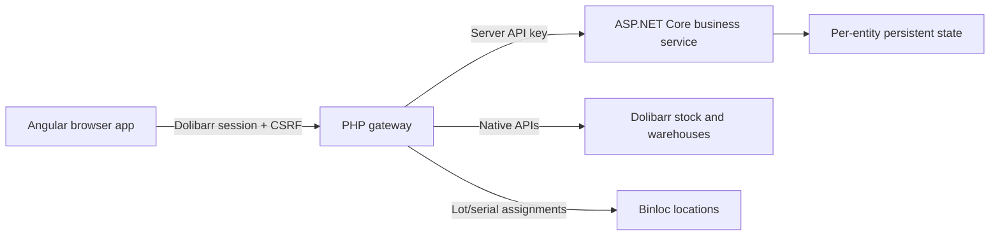

# QR Router 3.4

An Angular frontend embedded in Dolibarr 21.0.2, a small PHP integration gateway, and a separate .NET 10 ASP.NET Core business service. This version targets a **clean installation** with empty QR inventory and no preconfigured employees or personal warehouses. It does not require data migration or the original PHP screens.

The Angular code follows DeltaNext's engineering conventions: Angular/Material 21.1.5, standalone components, signals, `inject()`, lazy routes, typed HTTP services and a shared module. Its visual layout is specific to Dolibarr: inherited typography/colors, compact sections and horizontal module navigation, without DeltaNext branding, dark sidebar or gradient cards. Material controls and overlays take their colors/fonts from the host's native controls; the module does not change document-level theme variables. C# follows DeltaNext's controller/service/repository/options/middleware organization. The supplied original module remains under `reference/module-2.6.14` as reference and test-fixture material; its documentation describes the old implementation.



Angular owns inventory views, scanner/manual input, registration/editing, workflows, labels, bin summaries, picking and personal warehouse settings. PHP owns the authenticated shell, session/permission/CSRF checks, trusted native lookups, stock execution, QR images and printable documents. C# owns identifiers, validation, inventory state, audit history, stock planning/staging/finalization, reconciliation, aggregation and picking allocation. The browser never receives the service API key or supplies trusted native movement evidence.

## Native serials and box lots

Tracked individuals use the user-entered **Dolibarr serial number**; counted containers use their **box name** as the native lot name. Both link to a physical Dolibarr product with lot/serial tracking already enabled. Their QR ID remains a separate, generated scanner lookup key. One native lot/serial can be linked to only one QR item. Native identity names are read-only in the module after linking; change native records in Dolibarr and refresh.

**Create** creates the lot/serial if needed, receives one unit for a serial or the entered quantity for a box, and saves its location through Binloc's per-lot API. Box quantities must be known. **Register items** links an existing lot with exactly the entered native warehouse quantity and does not increase stock. Receive existing inventory into the correct named lot in Dolibarr before registering it. Product creation, native stock movement and Binloc write permissions are required for these operations.

Dolibarr stock and Binloc are authoritative for linked quantities and locations. The service retains a planning/display cache and QR-specific audit/loan data; bootstrap and mutations refresh that cache from native records. Corrections, consumption, returns and warehouse handoffs use native lot stock movements. Transferring box contents subtracts from the source lot and adds to the destination lot in one transaction, leaving the warehouse's product total unchanged. Partial consumption restores the remaining box's Binloc assignment after Binloc's outgoing-movement trigger clears it. Serials allow at most one unit. A physical box/serial lot must occupy one warehouse; consolidate externally split lots before using them in QR Router. Generic labels keep their existing behavior.

On an existing installation, deploy the PHP module **and** rebuilt frontend **and** service together, then disable/re-enable QR Router to install its native synchronization receipt table. Existing unlinked records are not automatically migrated. Edit a tracked item or named box to link it; reconcile unknown quantities and any pending operations first. Keep backups of the service state and Dolibarr database together.

Serial/lot creation and metadata edits stage a durable intent in the service, commit lot stock, Binloc assignments and an operation receipt in one Dolibarr transaction, then finalize the QR link. A failed or interrupted request shows a pending synchronization banner. After the original request has ended and at least 30 seconds have passed, **Recover synchronization** resumes it, reusing committed receipts without repeating stock changes. **Cancel uncommitted synchronization** is allowed only when no native transaction committed. Warehouse workflows keep their existing per-item pending-operation reconciliation, now including Binloc evidence and the native batch in movement evidence.

## Build the installable module

Requirements: Node.js 24, Python 3 and the .NET 10 SDK. The installed Dolibarr server needs PHP cURL, GD/TCPDF for QR image generation, and the Product, Stock, Lot/Serial and Binloc modules. The location adapter targets Binloc 2.19.1, including `fetchAnyByLot`, `setRawValues` and `createOrUpdate`.

```sh
cd frontend
npm ci
cd ..
python tools/build-frontend.py
python tools/package.py
```

On Windows, use `npm.cmd` if PowerShell prevents invoking `npm.ps1`. The build copies hashed production bundles into `dolibarr/qrrouter/spa` and produces `artifacts/module_qrrouter-3.4.0.zip`. Dependencies, Angular caches, compiled bundles and test output are excluded from Git; `frontend/package-lock.json` is tracked. Always rebuild before packaging a source checkout. Production PHP requires neither Node nor an Angular development server.

The UI opens at `/custom/qrrouter/index.php`. Angular uses hash routes such as `#/inventory` and `#/items/23456X`, so Apache/Nginx rewrite rules are unnecessary. The installed module has one Dolibarr top-level menu entry; Angular provides its internal navigation. QR Router pages omit Dolibarr's left sidebar on desktop and mobile, without changing navigation on other Dolibarr pages. Bin content printouts are available under **Bins and locations**, box transfers under **Transfer contents between containers**, and QR picking sheets under **Picking**. The package contains the app and native print/media endpoints, not the original PHP screen implementation.

Scanning pages request camera access automatically when their scanner appears. Operators can stop or restart the camera, and manual or hardware-scanner entry remains available if camera access is denied. Leaving a scanning page releases its camera stream.

Scanner, registration and warehouse workflow screens use a workstation layout inspired by the public [Warehouse Scanner Pro listing](https://www.dolistore.com/product.php?id=3262&title=warehouse-scanner-pro&l=en) and its author's mobile screenshots: blue section headings, bordered operation context, large input targets and green confirmation buttons. The scan screen includes operation shortcuts and native lot/location/quantity details. Workflow review uses touch quantity steppers, live count differences and stacked product rows on phones. These styles are scoped to scanner screens; the rest of the module continues to inherit the Dolibarr theme.

### DYMO LabelWriter 550 labels

Select a DYMO size on **Print QR labels**, or use the DYMO link on an item and change **Label size** in the preview. Sizes are listed as height × width; each label prints landscape on its own page. Changing a batch's size preserves the batch and unassigned-only filter. A4 printing remains available. Printing uses the workstation's installed DYMO driver and the browser's normal print dialog.

| Label size | Available details, in addition to QR and full QR ID |
| --- | --- |
| 25 × 54 mm | Serial, product name, product REF; at least two detail rows |
| 32 × 57 mm | Adds distinct lot, combined warehouse/bin location and quantity |
| 36 × 89 mm | Adds separate warehouse and bin, and the item name when different from the product name |
| 54 × 101 mm | Also includes item type, stock/loan status and item notes |

These sizes follow the [DYMO LabelWriter standard label range](https://download.dymo.com/dymo/technical-data-sheets/230305_DYMO_LW_Rolls_Technical_Data_Sheet_v7.pdf). Only available extra values print, including zero quantities; a serial is not repeated as an identical lot. Larger profiles use bigger QR codes and type, and a two-column detail layout where space allows. Presets come from one shared `assets/label-profiles.json` catalog used by the gateway, frontend and print layout.

Install [DYMO Connect for Desktop and the 550 driver](https://www.dymo.com/labelwriter.html), load compatible Authentic DYMO labels in the selected size, and choose the LabelWriter 550 in the print dialog. Select the matching paper, landscape orientation, **100% / actual size**, **no margins**, and disable browser headers/footers. Check the first physical label for driver alignment before printing a full batch. Browser and PDF layout checks do not replace verification on the actual printer.

Every label contains the QR image and the complete QR lookup ID. Available details start with **serial number → short product name → product reference**. All three print when present; there are always at least two core detail rows. Missing core data is explicitly marked as unassigned. The product name comes from the Dolibarr product, with the item label as a fallback. Box lots are not mislabeled as serials. Long detail text shrinks to a size-specific minimum (5.5 pt on the smallest preset, up to 7.5 pt on the largest) and then shortens with an ellipsis to fit; the preview tooltip keeps the full value. The QR ID remains complete, including supported legacy IDs. Printing stays disabled until every QR image loads successfully.

Frontend changes must be rebuilt and deployed with the complete module directory, including `spa/`. Rebuilding the C# service alone does not deploy Angular or PHP changes. After copying an updated module, reload the page; restart PHP workers if opcode caching is configured to retain old PHP files.

## Docker deployment

1. Copy `.env.example` to `.env`. Set `QRR_SERVICE_API_KEY` to a random secret of at least 32 characters.
2. Start the business service:

   ```sh
   docker compose up -d --build --wait
   ```

3. Install `artifacts/module_qrrouter-3.4.0.zip` through Dolibarr's external-module installer, or copy the built `dolibarr/qrrouter` directory to `htdocs/custom/qrrouter`. Enable QR Router and its dependencies.
4. In Dolibarr, open **Setup → Modules/Applications → QR Router → configuration gear** (or `/custom/qrrouter/admin/setup.php`). Set:

   ```text
   Service URL: http://127.0.0.1:5087
   Service API key: <the same secret as .env>
   ```

   Save the settings. Only administrators can access this page. Settings are stored for the current Dolibarr entity through its native configuration API, including native secret encryption for the key. The saved key is never filled back into the form; leave the key field empty on later saves to keep it. No PHP/FPM environment variables are required or read for this connection. The C# container still gets its matching key from `.env` through Compose; the module cannot configure a separate service's startup environment.
5. Sign in using your normal Dolibarr administrator account. QR inventory starts empty; no sample accounts or inventory are installed. Configure physical products, lot/serial tracking, warehouses and Binloc levels in Dolibarr. Create new named serials/boxes to receive stock, or print labels and register stock already present in the corresponding native lot. Registration does not increase native stock.
6. Create active employee users in Dolibarr before using checkout. Give operators QR read/manage rights and, where needed, native stock movement rights. Personal warehouses can be mapped by an administrator or resolved/created through native Dolibarr APIs at checkout. Empty employee lists show setup guidance and disable checkout confirmation.

The default Compose configuration binds the API to host loopback, uses a persistent `qrrouter-data` volume at `/data`, runs as the non-root `app` user, drops capabilities and uses a read-only root filesystem with writable temporary storage. `/health` is a liveness endpoint; Docker invokes it through the application's `--healthcheck` mode. An empty or short API key prevents startup.

If Dolibarr runs in Docker, set `DOLIBARR_NETWORK` to its existing network and use:

```sh
docker compose -f compose.yaml -f compose.dolibarr.yaml up -d --build --wait
```

In QR Router's module settings, use `http://qrrouter-api:8080` as the service URL and the same secret. The override attaches the service to that existing network; it does not deploy or modify a Dolibarr database. Use HTTPS when PHP and the service communicate across hosts. Never expose the shared service key in Angular configuration.

To build the Angular module entirely with Docker, without installing Node locally:

```sh
docker buildx build --target dolibarr-module --output type=local,dest=artifacts/docker-module .
```

If your Docker installation does not support Buildx or reports `unknown flag: --output`, export from a temporary, stopped container instead:

```sh
docker build --target dolibarr-module -t qrrouter-module:3.4.0 .
mkdir -p artifacts/docker-module
module_container=$(docker create qrrouter-module:3.4.0 /unused)
docker cp "$module_container:/qrrouter" artifacts/docker-module/
docker rm "$module_container"
```

The temporary container is never started; `/unused` only supplies the command required to create a container from the artifact image.

The output is `artifacts/docker-module/qrrouter`, ready to copy to Dolibarr's `htdocs/custom`. The default Docker target remains the C# runtime; frontend dependencies are not included in the API runtime image. Docker image execution still needs verification on a machine with a running Docker daemon.

Use one service instance with a local persistent volume. File locks and atomic rename protect local writers; the store is not intended for distributed replicas/network filesystems. Back up the service volume, Dolibarr database, and QR thumbnail directory. `docker compose down` retains the volume; `down -v` removes it. No production database or user accounts are changed by the build or tests.

## Development and validation

```sh
dotnet build QrRouter.sln -c Release
dotnet run --project tests/QrRouterApi.Tests -c Release
python tests/http_smoke.py
python tests/angular_integration.py --php /path/to/php
```

For browser checks, install Playwright Chromium once, then run the complete gateway/browser fixture:

```sh
cd frontend
npx playwright install chromium
cd ..
python tests/angular_integration.py --php /path/to/php --browser
```

The C# console runner has no test-framework dependency; use `dotnet run`, not `dotnet test`. It covers identifiers, entity/permission isolation, quantities, concurrent state writes, optimistic revisions, native evidence, corruption handling and recovery. The HTTP smoke test starts the real ASP.NET host and restarts it with a pending operation. Gateway tests run the deployed PHP code against the real C# service and native Dolibarr-shaped mocks; browser checks run the built Angular app inside that PHP shell. They cover registration, native moves, picking, scanner validation, camera denial/cleanup, mobile navigation, fresh-install empty states, and inheritance from light/dark host themes. These are not tests against a live Dolibarr database or physical camera.

On Windows without PHP:

```sh
python tools/test-php-runtime.py
python tests/angular_integration.py --php artifacts/php-runtime/php.exe --extension-dir artifacts/php-runtime/ext --browser
```

The helper downloads portable PHP 8.3 into ignored `artifacts`, checks the official SHA-256, and changes no system configuration. `tests/php_integration.py` remains an alias for the current integration suite.

For frontend work, `npm start` runs Angular with a proxy to a PHP/Dolibarr host at `127.0.0.1:8088`; adjust `frontend/proxy.conf.json` to your development installation. Requests still need an authenticated Dolibarr session. Alternatively rebuild into `spa` and serve through Dolibarr to exercise the real host path. To run C# without Docker, set `AppSettings__ApiKey`, an absolute writable `AppSettings__DataDirectory`, and `ASPNETCORE_URLS=http://127.0.0.1:5087`, then run `dotnet run --project src/QrRouterApi`.

## Source formatting

Angular files use two-space indentation, single-quoted TypeScript strings, expanded templates and separate HTML/CSS files. PHP and C# use four-space indentation. `.editorconfig`, Prettier and the repository-local CSharpier tool keep this consistent without changing the Dolibarr visual theme. Reference files and generated output are excluded.

```sh
cd frontend
npm run format
npm run format:check
cd ..
dotnet tool restore
dotnet csharpier format src tests/QrRouterApi.Tests
dotnet csharpier check src tests/QrRouterApi.Tests
```

## Integration boundary

Angular calls `api.php` on the same origin. GET resources supply bootstrap data, products, warehouse levels, references, orders, bin summaries and picking. POST actions are explicitly allowed: metadata create/update/bulk/register, count establishment, box-content transfer, native workflows, reconciliation, mappings and local label settings. Mutations carry the native Dolibarr form token and a session-bound QR CSRF token. There is no arbitrary service-command proxy. PHP rebuilds native facts from Dolibarr and ignores browser-supplied service headers, warehouses, effects and patches.

Stock mutations follow a recoverable sequence:

1. C# plans against authoritative state and returns its revision.
2. PHP checks physical product, warehouse, native quantity and lot/serial facts.
3. C# verifies the revision and durably stages a unique operation.
4. PHP executes the native Dolibarr stock transaction using that inventory code.
5. C# finalizes only after PHP supplies evidence of exactly the expected native movements.

Failures retain pending operations for investigation/reconciliation. Full evidence completes an operation, zero evidence can cancel an old operation, and partial/conflicting evidence blocks automatic changes. Confirm that the original request has ended before reconciling; the 30-second minimum alone does not prove it has stopped. Do not automatically retry timed-out stock mutations. Same-warehouse bin changes for native-linked items update Binloc without changing stock. Already-posted consumption/returns remain available for unlinked generic inventory; linked serials and boxes require native posting through the module, while direct Dolibarr adjustments appear after refresh.

The API key authenticates the trusted PHP adapter. Its entity, user and permission headers are assertions from the Dolibarr session, not independent browser credentials. The C# service has no direct Dolibarr database connection. The `/api/inventory` API is private to that integration.

Dutch and French UI text comes from the existing Dolibarr translation catalog plus `langs/nl.spa.json` and `langs/fr.spa.json`; missing translations fall back to English. The QR decoder is bundled locally, with no camera-decoder CDN dependency. Camera access needs a secure browser context and user permission.
