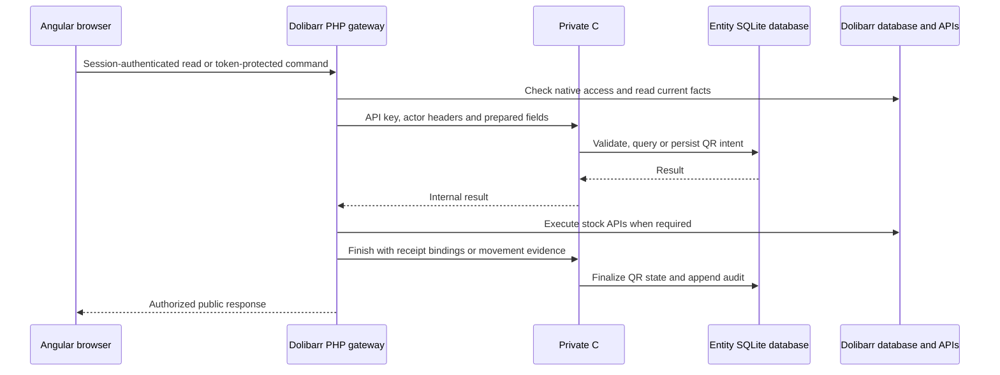

# Architecture and request flow

## The three runtime layers

QR Router is a Dolibarr module backed by a private ASP.NET Core service. Its Angular application runs inside a Dolibarr session. The browser talks to the module's PHP gateway, which constructs trusted service requests and invokes native Dolibarr APIs.

The native-execution and finish steps apply to stock operations, not every read or metadata edit. The [synchronization guide](synchronization.md) distinguishes the two native protocols.

| Layer                  | Owns                                                                                             | Must obtain elsewhere                                                                        |
| ---------------------- | ------------------------------------------------------------------------------------------------ | -------------------------------------------------------------------------------------------- |
| Angular                | Navigation, capture, review, form validation and display                                         | Authorization decisions and stock evidence from PHP                                          |
| PHP module             | Dolibarr session, CSRF, object access, native facts, stock APIs, media and print authorization   | QR domain planning and durable QR state from C#                                              |
| C# service             | QR identifiers, domain validation, location rules, plans, intents, queries and persistence       | Dolibarr permissions, native identities and movement evidence from the authenticated adapter |
| Dolibarr database      | Products, warehouses, lot/serial identities, stock movements and native synchronization receipts | QR metadata and internal location definitions from the service                               |
| Entity SQLite database | QR records, configuration, pending intent and audit                                              | Live native quantities from PHP observations                                                 |

## Read flow

`app.php` hosts the built application. `InventoryService.refresh()` in Angular requests `api.php?resource=bootstrap`. PHP checks inventory access, fetches private service state, overlays native observations and applies the explicit browser projection in `qrr_browser_inventory()`. The response includes the allowed items, catalogs, capability flags, form tokens and translations.

Live native observations can change a linked item's displayed warehouse, quantity or status after an adjustment made directly in Dolibarr. They are authoritative facts supplied by PHP, not browser edits. Pending operations retain their original intent so an observation cannot silently overwrite the operation being reconciled. Specialized read models use service queries and authorized native facts instead of sending raw state to the browser.

## Write flow

The Angular service encodes a command as a form POST with `action`, native `token`, module `qrr_token` and JSON `payload`. `api.php` validates the session and tokens, limits payload size, checks the action grant and builds allowed fields. Native product, warehouse, user and document data are loaded on the server.

`qrrouter_service.lib.php` supplies the API key and actor headers. `InventoryService.Execute()` checks capabilities again and routes the command. Writes run inside `StateRepository.Update()`; a successful callback changes state, advances the entity revision and appends an audit entry in one SQLite transaction. A thrown exception rolls the transaction back.

Native-linked creation and stock workflows require an additional transaction in Dolibarr. There is no transaction spanning both databases. Durable intents and native receipts or movement evidence bridge that gap. A timeout must therefore leave a recoverable operation rather than encourage a new stock request.

## Startup and deployment boundaries

`Program.cs` optionally loads an absolute `QRR_CONFIG_FILE`, then reapplies environment and command-line overrides. It validates the service key and external persistent data directory at startup. Error middleware wraps API-key middleware and controllers. `/health` is available without the API key; it is a process health response, not a native stock reconciliation check.

`tools/build-frontend.py` compiles Angular and the standalone print modules and copies them into the module's `spa` directory. PHP, frontend and service form a matching deployment; rebuilding the service alone does not install interface changes. See [testing and maintenance](testing-and-maintenance.md) for packaging and version checks.
